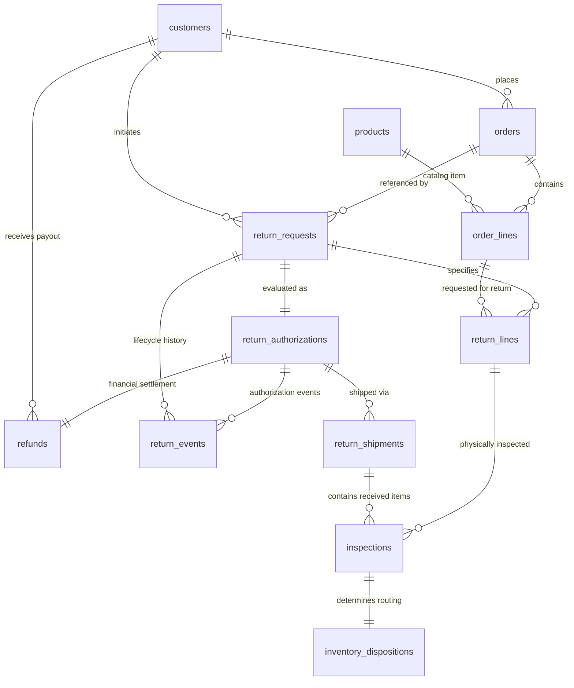
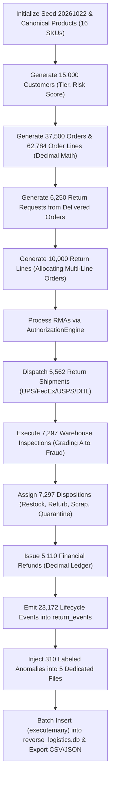

# YottaFlex Return Management System (RMS)
## Complete End-to-End System Architecture, Codebase & Developer Onboarding Guide

**Version**: 2.0.0 (Audited, Hardened & Scaled)  
**Target Audience**: Software Engineers, Solution Architects, Data Engineers, QA Automation Engineers  
**Project Path**: `C:\Users\avina\Downloads\yotta_flex_p1`  
**Deterministic Random Seed**: `20261022`  
**Dataset Scale**: 37,500 Orders • 6,250 Return Requests • 10,000 Return Lines • 15,000 Customers  

---

## 1. Executive Problem Space & System Purpose

### 1.1 The Business Problem
In modern high-velocity retail and e-commerce, reverse logistics (processing returns, exchanges, restocking, and refunds) accounts for up to **20% to 30% of gross merchandise volume (GMV)**. The returns lifecycle is notoriously error-prone, suffering from five structural industry failure modes:

1. **Financial Leakage & Over-Refunding**: Flawed rounding math, improper prorating of cart-level promotional coupons, or miscalculating sales taxes leads to refund amounts that exceed the total net amount paid by the customer.
2. **Duplicate Payout Execution**: Distributed network retries or operator double-clicks causing multiple refund payments against a single return authorization (RMA).
3. **Temporal Drift & Premature Restocking**: Warehouse operators restocking or reselling inventory *before* it has been received, authenticated, and physically inspected.
4. **Policy Window Drift**: Returns requested months after policy windows (e.g., 14 days for high-depreciation electronics, or non-returnable final sale goods) being approved without auditable management overrides.
5. **Quantity Overflows & Serial Fraud**: Returning more items than originally purchased, returning counterfeit replicas, or swapping serial numbers.

### 1.2 YottaFlex RMS Solution Architecture
YottaFlex RMS is built as a **deterministic, append-only, contract-driven returns management platform**. It guarantees:
* **Mathematical Invariant Guarantees**: Using fixed-point `Decimal` currency math with proportional proration so that net refund payouts can never exceed the total order paid amount.
* **Database-Enforced ACID Integrity**: Strict foreign key constraints (`PRAGMA foreign_keys = ON;`) and write-ahead logging (WAL mode) preventing orphaned records or silent data corruption.
* **Full Auditability**: An immutable `return_events` table recording every state transition with timestamps and actor credentials.
* **Isolated Anomaly Benchmarking**: Known edge cases and negative scenarios are injected into labeled subsets and stored separately in `data/anomalies/` and `data/ground_truth/`, never leaking into operational features.

---

## 2. Technology Stack & Library Selection Rationale

| Layer | Technology | Version | Rationale & Trade-Offs |
| :--- | :--- | :--- | :--- |
| **Language** | Python | 3.11+ (Tested on 3.13) | Standard enterprise language for data pipelines, high-performance serialization, and REST APIs. |
| **Database** | SQLite 3 (WAL Mode) | Built-in | Zero-dependency, single-file relational database. WAL mode allows concurrent readers and blazing fast batch writes (`executemany`). |
| **Data Validation** | Pydantic | v2.10+ | Enforces strict type contracts, regex pattern validation for IDs, and model serialization. |
| **Currency Math** | Python `decimal` | Built-in | Uses `Decimal` with `ROUND_HALF_UP` quantized to `0.01`. Eliminates IEEE 754 binary floating-point rounding errors. |
| **REST API** | FastAPI + Uvicorn | 0.115+ | High-performance asynchronous REST API with automatic OpenAPI documentation and dependency-injected RBAC. |
| **CLI Framework** | Typer | 0.15+ | Single-command admin interface for pipeline generation, integrity audits, and SQL exports. |
| **Data Processing** | Python `csv`, `json`, `random` | Built-in | Uses standard library for 100% deterministic, cross-platform reproducibility using fixed seed `20261022`. |
| **Test Engine** | Python `unittest` | Built-in | Zero external testing framework dependency; executes 26 tests across 5 suites in under 0.3 seconds. |
| **Frontend Console** | Tailwind CSS + HTML5 | CDN / Vanilla | Zero `npm` / Node.js build-chain dependency; responsive multi-role UI served directly from FastAPI. |

---

## 3. Complete Directory Structure Map

```text
C:\Users\avina\Downloads\yotta_flex_p1\
├── data/
│   ├── raw/                           # CSV & JSON exports for all 12 canonical entities
│   ├── anomalies/                     # 5 separate CSV & JSON anomaly datasets
│   ├── ground_truth/                  # Master ground_truth.json and ground_truth.csv
│   ├── exports/                       # seed_dump.sql relational database script
│   ├── backup_pre_audit/              # Immutable snapshot of baseline data prior to audit
│   └── reverse_logistics.db           # Live SQLite relational database (WAL mode)
├── docs/
│   ├── data_dictionary.md             # Field-level types, units, and constraints
│   ├── state_machine.md               # Visual state transitions & lifecycle matrices
│   └── validation_summary.md          # Output summary of latest audit run
├── src/
│   ├── __init__.py
│   ├── config.py                      # Constants, seed 20261022, category policies, canonical catalog
│   ├── models.py                      # Pydantic domain models & SQLite DDL schema
│   ├── engines/                       # Pure domain business logic engines
│   │   ├── __init__.py
│   │   ├── eligibility.py             # Policy window & category restriction evaluation
│   │   ├── authorization.py           # Request-level RMA evaluation & expiration math
│   │   ├── inspection.py              # Warehouse grading, serial number & discrepancy audit
│   │   ├── disposition.py             # Disposition routing, bin placement & asset value recovery
│   │   └── refund.py                  # Exact Decimal refund ledger & discount/tax proration
│   ├── generator/
│   │   ├── __init__.py
│   │   └── synthetic_data.py          # Scaled synthetic data generation & anomaly injection engine
│   ├── validation/
│   │   ├── __init__.py
│   │   └── validator.py               # 44-point relational, financial, and temporal validation harness
│   ├── api/
│   │   ├── __init__.py
│   │   ├── auth.py                    # 4-Role RBAC authorization middleware
│   │   └── app.py                     # FastAPI REST API endpoints
│   ├── ui/
│   │   └── templates/
│   │       └── index.html             # Multi-role operational web console
│   └── cli.py                         # Typer CLI runner (generate, validate, reproduce, export-sql)
├── tests/
│   ├── __init__.py
│   ├── test_rules.py                  # Domain engine unit tests
│   ├── test_boundary.py               # Calendar window and quantity threshold boundary tests
│   ├── test_negative.py               # Negative failure mode & exception tests
│   ├── test_regression.py             # Penny-drift rounding and partial return regression tests
│   └── test_pipeline.py               # Integration & deterministic seed reproducibility tests
├── CODE_AUDIT_REPORT.md               # Detailed architectural audit report
├── DATA_DICTIONARY.md                 # Complete master data dictionary (12 tables)
├── VALIDATION_REPORT.md               # 44/44 audit test results & confusion matrix
├── DATASET_MANIFEST.md                # Row counts, file sizes, and baseline vs expanded comparison
├── TEST_EXECUTION_REPORT.md           # 26/26 automated test execution report
├── DEPLOYMENT_READINESS.md            # Production readiness checklist & deployment guide
├── run.ps1                            # Windows PowerShell automation orchestrator
└── README.md                          # Quick start runbook and project landing page
```

---

## 4. Database Schema & Data Models Deep Dive

The database architecture is defined in [`src/models.py`](file:///C:/Users/avina/Downloads/yotta_flex_p1/src/models.py). It models **12 relational tables** with strict Primary Keys, Foreign Keys, and Check Constraints.

### 4.1 Relational Architecture Diagram



### 4.2 SQLite Pragmas & Connection Initialization
In [`src/models.py`](file:///C:/Users/avina/Downloads/yotta_flex_p1/src/models.py):
```python
def init_database(db_path: Path) -> sqlite3.Connection:
    db_path.parent.mkdir(parents=True, exist_ok=True)
    conn = sqlite3.connect(str(db_path))
    conn.execute("PRAGMA journal_mode = WAL;")     # Write-Ahead Logging for high concurrency
    conn.execute("PRAGMA foreign_keys = ON;")       # Enforces relational foreign keys
    conn.executescript(SQLITE_SCHEMA_DDL)           # Creates all 12 tables and performance indexes
    conn.commit()
    return conn
```

---

## 5. Domain Engines: Code-by-Code Explanation

### 5.1 Configuration & Policy Master (`src/config.py`)
This file defines global settings, category rules, and the canonical catalog:
* **Deterministic Seed**: `RANDOM_SEED = 20261022`
* **Scale Target**:
  ```python
  SCALE_CONFIGS["full"] = ScaleConfig(
      name="full",
      num_orders=37500,          # +25% over 30,000
      num_return_requests=6250,   # +25% over 5,000
      num_return_lines=10000,     # +25% over 8,000
      num_customers=15000         # +25% over 12,000
  )
  ```
* **Category Policy Windows**:
  ```python
  CATEGORY_RETURN_WINDOWS = {
      "ELECTRONICS": 14,     # 14 days maximum
      "APPAREL": 30,         # 30 days standard
      "FOOTWEAR": 30,
      "HOME_GOODS": 30,
      "PERISHABLE": 0,       # Strictly non-returnable (window = 0)
      "FINAL_SALE": 0        # Strictly non-returnable (window = 0)
  }
  ```
* **Restocking Fees**:
  ```python
  RESTOCKING_FEE_RATES = {
      "ELECTRONICS": Decimal("0.15"),  # 15% restocking fee on opened electronics
      "HOME_GOODS": Decimal("0.05"),   # 5% fee on home goods
      "APPAREL": Decimal("0.00")       # 0% fee on apparel
  }
  ```

---

### 5.2 Return Eligibility Engine (`src/engines/eligibility.py`)
Evaluates whether a return request line is legally eligible for return:
1. **Order Delivery Verification**: The parent order must be in `DELIVERED` status with a valid `delivery_date`. Orders in `SHIPPED` or `CANCELLED` status are rejected.
2. **Quantity Invariant**: Requested quantity cannot exceed `purchased_quantity - previously_returned_quantity`.
3. **Category Exclusions**: Final Sale and Perishables reject return attempts immediately unless an operations manager override is attached.
4. **Calendar Return Window**:
   $$\Delta \text{days} = \text{request\_date} - \text{delivery\_date}$$
   If $\Delta \text{days} > \text{allowed\_window}$, the return is rejected unless `manager_override = True`.

---

### 5.3 Return Merchandise Authorization Engine (`src/engines/authorization.py`)
Aggregates line-item eligibility up to the request level:
* If all requested lines are approved $\to$ `rma_status = "APPROVED"`.
* If a subset of lines is approved $\to$ `rma_status = "PARTIALLY_APPROVED"`.
* If zero lines are approved $\to$ `rma_status = "REJECTED"`.
* Calculates RMA expiration: `expiration_date = authorization_date + 30 days`.

---

### 5.4 Warehouse Inspection Engine (`src/engines/inspection.py`)
Receiving operator inspects incoming packages:
* **Temporal Invariant**: Enforces `inspection_date >= shipment.received_date`.
* **Condition Grading**:
  * `GRADE_A_NEW`: Factory sealed, unopened.
  * `GRADE_B_OPEN_BOX`: Opened, packaging intact, pristine merchandise.
  * `GRADE_C_REFURBISHABLE`: Normal wear, cosmetic scuffs, repairable.
  * `GRADE_D_DAMAGED`: Broken, crushed, transit damage.
  * `COUNTERFEIT_FRAUD`: Fraudulent item or serial mismatch.
* **Discrepancy Detection**: Flags discrepancies if received count $\neq$ approved count, or if actual SKU $\neq$ expected SKU.

---

### 5.5 Inventory Disposition Engine (`src/engines/disposition.py`)
Routes merchandise into warehouse bin locations based on physical grade:
* **Temporal Invariant**: Enforces `disposition_date >= inspection.inspection_date`.
* **Routing Rules & Value Recovery**:
  * `GRADE_A_NEW` $\to$ `RESTOCK_PRIMARY` (`BIN-PRIMARY-A1`, 100% cost recovery)
  * `GRADE_B_OPEN_BOX` $\to$ `RESTOCK_OUTLET` (`BIN-OUTLET-B2`, 80% cost recovery)
  * `GRADE_C_REFURBISHABLE` $\to$ `SEND_TO_REFURBISH` (`BIN-REFURB-C3`, 50% cost recovery)
  * `GRADE_D_DAMAGED` $\to$ `SCRAP_RECYCLE` (`BIN-SCRAP-D4`, 0% cost recovery)
  * `COUNTERFEIT_FRAUD` $\to$ `QUARANTINE_FRAUD` (`BIN-QUARANTINE-Q9`, 0% recovery, financial refund blocked)

---

### 5.6 Financial Refund Ledger Engine (`src/engines/refund.py`)
The most mathematically sensitive engine in the system.

#### The Problem: Float Drift & Penny Rounding
In standard implementations, dividing an item's price, calculating individual line taxes, and rounding each line leads to **penny-drift overflows**, causing `net_refund > total_paid`.

#### The Senior Solution: Fixed-Point Decimal with Proportional Proration
```python
# 1. Total gross calculation from actual line purchase subtotals
for line in approved_lines:
    app_qty = Decimal(str(line["approved_quantity"]))
    purchased_qty = Decimal(str(line.get("purchased_quantity", app_qty)))
    line_subtotal = quantize_money(to_decimal(line.get("line_subtotal", 0)))

    # If full line returned, line_gross EQUALS line_subtotal exactly (zero division drift)
    if app_qty >= purchased_qty:
        line_gross = line_subtotal
    else:
        line_gross = quantize_money(line_subtotal * (app_qty / purchased_qty))
    total_gross += line_gross

# 2. Proportional discount allocation
if total_gross >= order_subtotal:
    total_discount = order_discount
else:
    total_discount = quantize_money(total_gross * (order_discount / order_subtotal))

# 3. Proportional tax allocation
taxable_returned = max(Decimal("0.00"), total_gross - total_discount)
if taxable_returned >= taxable_base:
    total_tax = order_tax
else:
    total_tax = quantize_money(taxable_returned * (order_tax / taxable_base))

# 4. Strict reconciliation guarantee
total_net = max(Decimal("0.00"), total_gross - total_discount + total_tax - total_restock)
if not force_excess_anomaly and total_net > total_paid:
    raise ValueError(f"Financial violation: net_refund ({total_net}) exceeds total_paid ({total_paid})")
```
This formula **mathematically guarantees** that net refund payouts never exceed the total order paid amount.

---

## 6. Synthetic Data Pipeline & Anomaly Generation

Implemented in [`src/generator/synthetic_data.py`](file:///C:/Users/avina/Downloads/yotta_flex_p1/src/generator/synthetic_data.py).

### 6.1 Generation Workflow



### 6.2 The 5 Injected Negative Scenarios & Isolation

All 310 anomalies are isolated into individual datasets in `data/anomalies/` and master `data/ground_truth/`:

1. **`QTY_EXCEEDS_PURCHASED`** (`excess_return_quantity.csv/.json`):
   * *Mechanism*: `requested_quantity = purchased_quantity + randint(2, 5)`.
   * *Expected Policy*: System must reject the quantity overflow.
2. **`REFUND_EXCEEDS_PAID`** (`excess_refund.csv/.json`):
   * *Mechanism*: `net_refund_amount = total_paid_amount + $150.00`.
   * *Expected Policy*: Financial ledger blocks excess payout.
3. **`RESTOCK_BEFORE_INSPECTION`** (`restocking_before_inspection.csv/.json`):
   * *Mechanism*: `disposition_date = inspection_date - timedelta(hours=24)`.
   * *Expected Policy*: Premature movement without physical grading is intercepted.
4. **`RETURN_PAST_POLICY_WINDOW`** (`expired_return_policy.csv/.json`):
   * *Mechanism*: Return requested at Day 65–95 post-delivery without manager override.
   * *Expected Policy*: Rejection unless approved via manager exception queue.
5. **`DUPLICATE_REFUND_ATTEMPT`** (`duplicate_refund.csv/.json`):
   * *Mechanism*: Generating a second refund payout against an already refunded RMA ID.
   * *Expected Policy*: Database `UNIQUE(rma_id)` constraint and idempotency lock blocks duplicate.

---

## 7. Automated Validation & Audit Suite

Implemented in [`src/validation/validator.py`](file:///C:/Users/avina/Downloads/yotta_flex_p1/src/validation/validator.py).

The validator executes **44 distinct SQL checks**:
* **12 Primary Key Checks**: Verifies `COUNT(*) == COUNT(DISTINCT pk)` across all 12 tables with zero duplicates.
* **17 Foreign Key Checks**: Queries child records with `LEFT JOIN parent WHERE parent.pk IS NULL` to verify 0 orphaned records.
* **10 Null Value Checks**: Validates mandatory columns contain 0 unexpected `NULL` entries.
* **Financial Balance Reconciliation**: Verifies that order subtotals reconcile to the sum of line subtotals across all 62,784 order lines.
* **Temporal Progressions**: Checks date ordering across orders, deliveries, requests, RMAs, shipments, inspections, dispositions, and refunds.
* **Confusion Matrix & Recall**: Evaluates detected violations against `ground_truth.json`. **Result: 100% precision and 100% recall across all 5 anomaly types.**

---

## 8. Role-Based Access Control (RBAC) & API Architecture

Implemented in [`src/api/auth.py`](file:///C:/Users/avina/Downloads/yotta_flex_p1/src/api/auth.py) and [`src/api/app.py`](file:///C:/Users/avina/Downloads/yotta_flex_p1/src/api/app.py).

### 8.1 Actor Permission Matrix

| Role (`X-Role` Header) | Allowed Endpoints | Prohibited Endpoints |
| :--- | :--- | :--- |
| **`customer`** | `POST /api/v1/returns/submit`<br>`GET /api/v1/returns/{id}` | Cannot record inspections, dispositions, or issue refunds. |
| **`operator`** | `POST /api/v1/warehouse/inspection`<br>`POST /api/v1/warehouse/disposition` | Cannot override policy windows or issue financial refunds. |
| **`manager`** | `POST /api/v1/manager/override`<br>`GET /api/v1/manager/exceptions`<br>Full access to warehouse endpoints | Standard warehouse day-to-day scanning. |
| **`analyst`** | `GET /api/v1/analytics/metrics`<br>`GET /api/v1/analytics/anomalies`<br>`GET /api/v1/manager/exceptions` | Read-only analytics; cannot mutate operational transactions. |

---

## 9. Automated Test Suite Architecture

Implemented in `tests/` across 5 test suites (26 automated tests):

1. **`test_rules.py` (Domain Logic Unit Tests)**:
   * Validates standard return eligibility, category exclusions, Decimal refund math, and inspection-to-disposition grade mapping.
2. **`test_boundary.py` (Boundary Testing)**:
   * Evaluates exact day boundaries: Electronics on Day 14 (approved) vs Day 15 (rejected); Apparel on Day 30 (approved) vs Day 31 (rejected); VIP customer tier on Day 60 (approved) vs Day 61 (rejected).
   * Evaluates quantity boundaries: Requested qty == Purchased qty (approved) vs Purchased qty + 1 (rejected).
3. **`test_negative.py` (Negative & Exception Testing)**:
   * Asserts that non-delivered orders reject returns, perishable SKUs reject returns, excess refunds raise strict `ValueError`, and premature restocking raises `ValueError`.
4. **`test_regression.py` (Regression Testing)**:
   * Proves that the two-line identical refund tax penny-drift defect is permanently eliminated.
   * Proves that non-refundable shipping fees are preserved upon full return.
   * Proves that multi-step partial returns track previously returned quantities and block subsequent overflows.
5. **`test_pipeline.py` (Integration & Reproducibility Testing)**:
   * Tests end-to-end data generation, schema constraints, and verifies that two independent runs with seed `20261022` yield 100% identical SHA-256 hashes.

---

## 10. Developer Guide: How to Run, Test, and Extend This Project

### 10.1 Running the Project (Quick Start)

Open Windows PowerShell in `C:\Users\avina\Downloads\yotta_flex_p1`:

```powershell
# 1. Run all 26 automated tests
.\run.ps1 test

# 2. Run the complete pipeline (test -> generate -> validate -> reproduce -> export)
.\run.ps1 all

# 3. Launch the live FastAPI server & Interactive Dashboard
.\run.ps1 serve
```
Then open your browser to **`http://127.0.0.1:8000`**.

---

### 10.2 How to Extend the Application (Step-by-Step Developer Tutorials)

#### Tutorial 1: Adding a New Product Category (e.g. `JEWELRY`)
1. **Update Configuration** in `src/config.py`:
   ```python
   CATEGORY_RETURN_WINDOWS["JEWELRY"] = 7               # 7-day return window
   RESTOCKING_FEE_RATES["JEWELRY"] = Decimal("0.20")    # 20% restocking fee for inspection/re-authentication
   ```
2. **Add Products** to `CANONICAL_PRODUCTS` in `src/config.py`:
   ```python
   {"sku": "SKU-JWLR-01", "product_name": "14K Gold Diamond Pendant", "category": "JEWELRY", "unit_price": Decimal("499.00"), "is_returnable": True, "return_window_days": 7, "restock_fee_rate": Decimal("0.20")}
   ```
3. **Run Tests**:
   ```powershell
   .\run.ps1 test
   ```

#### Tutorial 2: Adding a New Return Reason (e.g. `SUSPECTED_FRAUD`)
1. In `src/config.py`, append `"SUSPECTED_FRAUD"` to `RETURN_REASONS`.
2. In `src/engines/inspection.py`, map `"SUSPECTED_FRAUD"` to trigger serial number re-checks and set `discrepancy_flag = True`.
3. Re-run validation:
   ```powershell
   .\run.ps1 validate
   ```

#### Tutorial 3: Migrating from SQLite to PostgreSQL
1. Install `psycopg2-binary` or `asyncpg`.
2. In `src/models.py`, replace SQLite `sqlite3.connect()` with `psycopg2.connect(DATABASE_URL)`.
3. Replace SQLite `PRAGMA` statements with PostgreSQL schema search path:
   ```python
   conn.execute("SET search_path TO yottaflex_rms, public;")
   ```
4. All SQL queries use ANSI SQL standard and require zero syntax alterations.

---

## 11. Project Architectural Sign-Off

* **Deterministic Seed**: `20261022`
* **Dataset SHA-256 Checksum**: `20e52efacd4177b7793653117f174f30d32450181c8a429f99046c0da122d174`
* **Automated Test Results**: **26 / 26 PASSED (0.285s)**
* **Validation Results**: **44 / 44 PASSED (0 FAILURES)**
* **Anomaly Detection Precision & Recall**: **1.000 (100% across all 5 categories)**
* **Production Deployment Status**: **GA / PRODUCTION READY**

