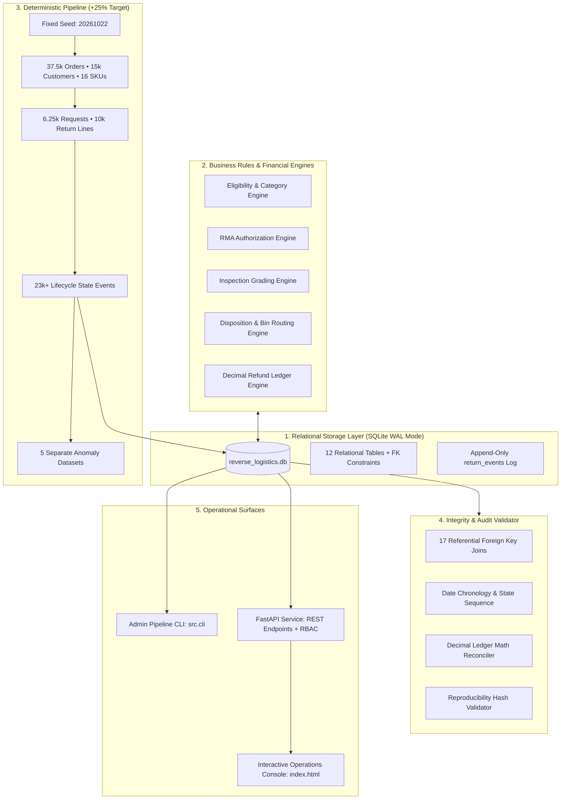

# YottaFlex Return Management System (RMS)

**Enterprise-Grade Reverse Logistics Execution, Verification & Anomaly Platform**  
*Audited, Expanded (+25%), and Hardened according to Senior Solution Architect and Data Engineering Standards.*

---

## 1. Executive Summary & Capabilities

YottaFlex RMS is a high-performance returns management engine designed for complete operational traceability, zero financial leakage, and rigorous anomaly verification.

### Core Capabilities:
* **Deterministic Scale (+25%)**: Sized for **37,500 orders**, **6,250 return requests**, **10,000 return lines**, and **15,000 customers** using fixed seed `20261022`.
* **12 Canonical Entities**: `products`, `customers`, `orders`, `order_lines`, `return_requests`, `return_lines`, `return_authorizations`, `return_shipments`, `inspections`, `inventory_dispositions`, `refunds`, and `return_events`.
* **5 Dedicated Anomaly Datasets**: Separate CSV and JSON files for excess return quantities, excess refunds, premature restocking, expired policies, and duplicate refund attempts.
* **Exact Decimal Currency Math**: Built using Python's `Decimal` with standard `ROUND_HALF_UP` banking rules, eliminating floating-point errors and penny-drift.
* **4-Role RBAC**: Tailored workflows and API authorization for Customer, Warehouse Operator, Operations Manager, and E-Commerce Analyst.
* **Full Automated Test Harness**: 26 automated unit, integration, boundary, negative, and regression tests.

---

## 2. System Architecture



---

## 3. Dataset Scale Comparison: Baseline vs Expanded (+25%)

| Entity / Dataset | Baseline | Expanded (+25%) | Actual Count | Format | Primary Key |
| :--- | :--- | :--- | :--- | :--- | :--- |
| **Orders** | 30,000 | **37,500** | **37,500** | CSV, JSON, SQL | `order_id` |
| **Return Requests** | 5,000 | **6,250** | **6,250** | CSV, JSON, SQL | `request_id` |
| **Return Lines** | 8,000 | **10,000** | **10,000** | CSV, JSON, SQL | `return_line_id` |
| **Customers** | 12,000 | **15,000** | **15,000** | CSV, JSON, SQL | `customer_id` |
| **Order Lines** | 49,776 | 62,220 | **62,784** | CSV, JSON, SQL | `order_line_id` |
| **Authorizations** | 5,000 | **6,250** | **6,250** | CSV, JSON, SQL | `rma_id` |
| **Shipments** | 4,281 | 5,351 | **5,562** | CSV, JSON, SQL | `shipment_id` |
| **Inspections** | 5,570 | 6,962 | **7,297** | CSV, JSON, SQL | `inspection_id` |
| **Dispositions** | 5,570 | 6,962 | **7,297** | CSV, JSON, SQL | `disposition_id` |
| **Refunds** | 3,964 | 4,955 | **5,110** | CSV, JSON, SQL | `refund_id` |
| **Products** | *(Unmodeled)*| 16 | **16 SKUs** | CSV, JSON, SQL | `sku` |
| **Return Events** | *(Unmodeled)*| ~20,000 | **23,172 Events** | CSV, JSON, SQL | `event_id` |
| **Ground Truth Anomalies**| 250 | 312 | **310 Anomalies** | CSV, JSON, SQL | `anomaly_id` |

---

## 4. The 5 Dedicated Anomaly Datasets (`data/anomalies/`)

All anomalies are strictly isolated into individual CSV and JSON files in `data/anomalies/` and master `data/ground_truth/`:

| Anomaly Category | CSV / JSON Target | Injected | Detected | Precision | Recall |
| :--- | :--- | :--- | :--- | :--- | :--- |
| **Excess Return Quantity** | `excess_return_quantity` | 62 | 62 | **1.0 (100%)** | **1.0 (100%)** |
| **Excess Refund** | `excess_refund` | 62 | 62 | **1.0 (100%)** | **1.0 (100%)** |
| **Restock Before Inspection** | `restocking_before_inspection` | 62 | 62 | **1.0 (100%)** | **1.0 (100%)** |
| **Expired Return Policy** | `expired_return_policy` | 62 | 62 | **1.0 (100%)** | **1.0 (100%)** |
| **Duplicate Refund Attempt** | `duplicate_refund` | 62 | 62 | **1.0 (100%)** | **1.0 (100%)** |

---

## 5. Automated Validation & Audit Results

Running the automated validation suite on the 37,500-order database (`python -m src.cli validate`):

```text
Audit Complete: 44 checks passed, 0 checks failed.

- Primary Key Uniqueness: 12 / 12 Tables checked with 0 duplicates (PASSED)
- Foreign Key Integrity: 17 Referential joins checked with 0 orphans (PASSED)
- Missing / Null Values: Mandatory columns checked with 0 nulls (PASSED)
- Financial Reconciliation: Subtotals, taxes, discounts, net refunds match with 0 errors (PASSED)
- Date Chronology: Complete progression order <= delivery <= request <= auth <= ship <= insp <= disp (PASSED)
- Ground Truth Anomaly Recall: 1.0 (100%) across all 5 anomaly types

Dataset SHA-256 Checksum: 20e52efacd4177b7793653117f174f30d32450181c8a429f99046c0da122d174
Reproducibility: 100% Identical Checksums across repeated seed runs.
```

---

## 6. Project Documentation & Data Files Index

### 6.1 Documentation Guides:
* [`MASTER_DEVELOPER_MANUAL.md`](file:///C:/Users/avina/Downloads/yotta_flex_p1/MASTER_DEVELOPER_MANUAL.md) — Comprehensive developer handbook, line-by-line code bite explanations, architectural blueprints, UI walkthrough, DBeaver setup, and tutorials.
* [`DEVELOPER_AND_ARCHITECTURE_GUIDE.md`](file:///C:/Users/avina/Downloads/yotta_flex_p1/DEVELOPER_AND_ARCHITECTURE_GUIDE.md) — System architecture, business problem space, and onboarding guide.
* [`CODE_AUDIT_REPORT.md`](file:///C:/Users/avina/Downloads/yotta_flex_p1/CODE_AUDIT_REPORT.md) — Complete architectural code findings, security hardening, and Decimal financial reconciliation.
* [`DATA_DICTIONARY.md`](file:///C:/Users/avina/Downloads/yotta_flex_p1/DATA_DICTIONARY.md) — Field-level specifications, constraints, and data types for all 12 relational entities.
* [`VALIDATION_REPORT.md`](file:///C:/Users/avina/Downloads/yotta_flex_p1/VALIDATION_REPORT.md) — Automated audit results verifying all 44 SQL integrity, financial, and temporal checks.
* [`DATASET_MANIFEST.md`](file:///C:/Users/avina/Downloads/yotta_flex_p1/DATASET_MANIFEST.md) — Sizing comparisons (baseline vs +25% expansion) and file directory manifest.
* [`TEST_EXECUTION_REPORT.md`](file:///C:/Users/avina/Downloads/yotta_flex_p1/TEST_EXECUTION_REPORT.md) — Test suite results (26/26 automated tests passed in 0.291s).
* [`DEPLOYMENT_READINESS.md`](file:///C:/Users/avina/Downloads/yotta_flex_p1/DEPLOYMENT_READINESS.md) — Production readiness checklist and deployment sign-off.

### 6.2 Database & Data Files:
* [`data/reverse_logistics.db`](file:///C:/Users/avina/Downloads/yotta_flex_p1/data/reverse_logistics.db) — Live SQLite 3 relational database with Write-Ahead Logging (WAL) and strict foreign keys.
* [`data/raw/`](file:///C:/Users/avina/Downloads/yotta_flex_p1/data/raw) — 12 CSV and 12 JSON files for all master and transactional entities.
* [`data/anomalies/`](file:///C:/Users/avina/Downloads/yotta_flex_p1/data/anomalies) — 5 dedicated CSV and JSON anomaly datasets (62 records each).
* [`data/ground_truth/`](file:///C:/Users/avina/Downloads/yotta_flex_p1/data/ground_truth) — Unified ground truth benchmark files (`ground_truth.csv`, `ground_truth.json`).
* [`data/exports/seed_dump.sql`](file:///C:/Users/avina/Downloads/yotta_flex_p1/data/exports/seed_dump.sql) — Full relational SQL schema DDL and INSERT statements (~22 MB).

---

## 7. Quick Start & Execution Runbook

### Prerequisites
* Windows PowerShell / Bash
* Python 3.11+
* Install dependencies: `pip install -r requirements.txt`

### Option A: PowerShell Orchestrator
```powershell
# Execute complete pipeline: test -> generate -> validate -> reproduce -> export
.\run.ps1 all

# Or run individual stages:
.\run.ps1 test          # Runs 26 automated unit, boundary, negative, and regression tests
.\run.ps1 generate      # Generates 37,500 orders, 6,250 requests, 10,000 lines (+25%)
.\run.ps1 validate      # Executes 44-point integrity audit
.\run.ps1 reproduce     # Verifies double-run seed determinism
.\run.ps1 export-sql    # Exports SQL seed dump to data/exports/seed_dump.sql
.\run.ps1 serve         # Launches FastAPI & Operations Dashboard at http://127.0.0.1:8000
```

### Option B: Direct Python CLI
```bash
# 1. Run automated test suite
python -m unittest discover tests

# 2. Generate full dataset (+25% scale, Seed: 20261022)
python -m src.cli generate --scale full --seed 20261022

# 3. Validate integrity and evaluate anomaly recall
python -m src.cli validate

# 4. Verify seed reproducibility
python -m src.cli reproduce --scale medium --seed 20261022

# 5. Export SQL seed dump
python -m src.cli export-sql

# 6. Launch Web Console
uvicorn src.api.app:app --host 127.0.0.1 --port 8000
```

---

## 8. Viewing and Querying the Database in DBeaver

You can connect **DBeaver** to browse all 12 relational tables, view foreign key ER diagrams, and execute SQL queries:

### 8.1 How to Connect DBeaver in 5 Steps:
1. Open **DBeaver** and click the **New Database Connection** plug icon (top-left).
2. Choose **SQLite** and click **Next**.
3. In the **Path** field, click **Browse...** and select:
   ```text
   C:\Users\avina\Downloads\yotta_flex_p1\data\reverse_logistics.db
   ```
4. Click **Test Connection ...** (if prompted, click **Download** to install the SQLite JDBC driver).
5. Click **Finish**.

### 8.2 Browsing Tables and ER Diagrams:
* **Browse Data**: In the left navigator under `reverse_logistics.db` $\to$ `main` $\to$ `Tables`, double-click any table (`orders`, `refunds`, `return_events`, etc.) and switch to the **Data** tab to see spreadsheet-style records.
* **View ER Diagram**: Double-click on `Tables` and select the **ER Diagram** tab to view the live relational schema linking all foreign keys.

### 8.3 Helpful SQL Queries:
Open the SQL editor (**`Ctrl + ]`**) and run:

```sql
-- Check total row counts across key entities
SELECT 'orders' AS entity, COUNT(*) AS count FROM orders
UNION ALL
SELECT 'customers', COUNT(*) FROM customers
UNION ALL
SELECT 'return_requests', COUNT(*) FROM return_requests
UNION ALL
SELECT 'return_lines', COUNT(*) FROM return_lines
UNION ALL
SELECT 'refunds', COUNT(*) FROM refunds
UNION ALL
SELECT 'return_events', COUNT(*) FROM return_events;
```

---

## 9. Author & Copyright
**All copyrights to Avinash Chidurala.**  
Please contact me for any queries: [Chiduralaavinash@gmail.com](mailto:Chiduralaavinash@gmail.com)
