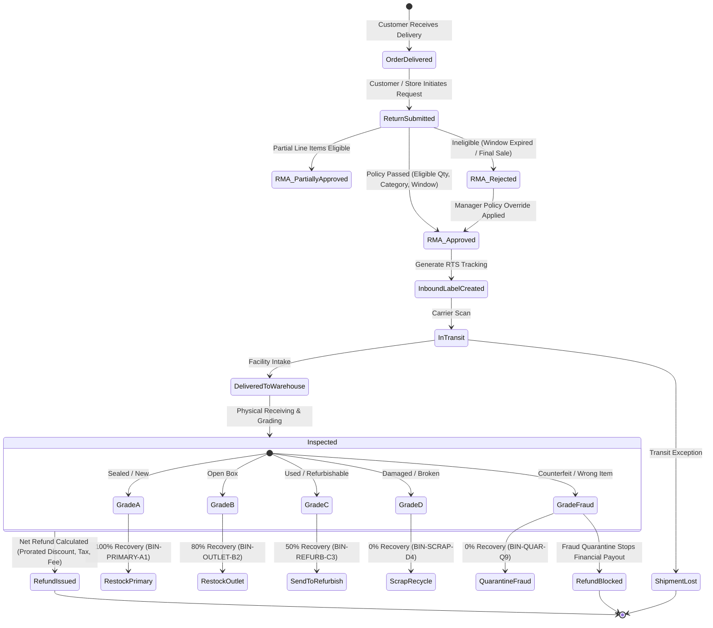

# Reverse Logistics State Machine & Lifecycle Matrix

This document defines the formal state transitions, invariants, and guard conditions across the returns lifecycle.

---

## 1. End-to-End Lifecycle State Diagram

---

## 2. Entity State Transition Matrices

### 2.1 ReturnRequest (`return_requests`)
* Initial State: `SUBMITTED`
* Possible States: `SUBMITTED`, `UNDER_REVIEW`, `APPROVED`, `PARTIALLY_APPROVED`, `REJECTED`, `CANCELLED`

| From State | Event / Trigger | Guard Conditions | To State |
| :--- | :--- | :--- | :--- |
| `SUBMITTED` | Policy Evaluation | All lines eligible and within return window | `APPROVED` |
| `SUBMITTED` | Policy Evaluation | Subset of lines eligible | `PARTIALLY_APPROVED` |
| `SUBMITTED` | Policy Evaluation | All lines exceed window, final sale, or excess qty | `REJECTED` |
| `REJECTED` | Manager Review | `manager_override = TRUE` with logged reason | `APPROVED` |
| Any | Customer Cancel | Return shipment not yet created | `CANCELLED` |

---

### 2.2 ReturnShipment (`return_shipments`)
* Initial State: `LABEL_CREATED`
* Possible States: `LABEL_CREATED`, `IN_TRANSIT`, `DELIVERED`, `EXCEPTION_LOST`, `RETURNED_TO_SENDER`

| From State | Event / Trigger | Guard Conditions | To State |
| :--- | :--- | :--- | :--- |
| `LABEL_CREATED` | Carrier Origin Scan | Carrier receives parcel | `IN_TRANSIT` |
| `IN_TRANSIT` | Facility Destination Scan | Arrives at assigned warehouse dock | `DELIVERED` |
| `IN_TRANSIT` | Carrier Tracking Stalled | No movement for > 14 business days | `EXCEPTION_LOST` |
| `IN_TRANSIT` | Address/Label Undeliverable | Customer package unreturnable | `RETURNED_TO_SENDER` |

---

### 2.3 InventoryDisposition (`inventory_dispositions`)
* Prerequisite Guard: **`disposition_date >= inspection_date`**

| Item Grade | Physical Condition | Target Action | Warehouse Bin Location | Asset Value Recovery |
| :--- | :--- | :--- | :--- | :--- |
| `GRADE_A_NEW` | Factory sealed, perfect condition | `RESTOCK_PRIMARY` | `BIN-PRIMARY-A1` | 100% of purchase unit price |
| `GRADE_B_OPEN_BOX` | Opened packaging, pristine merchandise | `RESTOCK_OUTLET` | `BIN-OUTLET-B2` | 80% of purchase unit price |
| `GRADE_C_REFURBISHABLE` | Minor cosmetic wear, all parts present | `SEND_TO_REFURBISH` | `BIN-REFURB-C3` | 50% of purchase unit price |
| `GRADE_D_DAMAGED` | Crushed, broken, water damage | `SCRAP_RECYCLE` | `BIN-SCRAP-D4` | 0% (Scrapped & recycled) |
| `COUNTERFEIT_FRAUD` | Serial number mismatch, bootleg goods | `QUARANTINE_FRAUD` | `BIN-QUARANTINE-Q9`| 0% (Evidence locker) |

---

### 2.4 Refund (`refunds`)
* Guard: **`net_refund_amount <= order.total_paid_amount`**
* Guard: **`UNIQUE (rma_id)`** (Idempotency enforcement)

$$\text{Net Refund} = (\text{Approved Qty} \times \text{Unit Price}) - \text{Prorated Discount} + \text{Prorated Tax} - \text{Restocking Fee}$$

* Restocking Fee Waived when Return Reason $\in \{\text{DEFECTIVE}, \text{WRONG\_ITEM}\}$.
* 15% Restocking Fee applied to `ELECTRONICS` if Return Reason is `CHANGED_MIND`.

